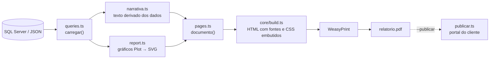

<p align="center">
  <picture>
    <source media="(prefers-color-scheme: dark)" srcset="https://shieldcn.dev/header/graph.svg?title=Gerador+de+Relat%C3%B3rios&subtitle=PDF+executivo+A4+a+partir+do+banco+do+cliente&logo=bun&align=left&mode=dark" />
    
  </picture>
</p>

<p align="center">
  <picture>
    <source media="(prefers-color-scheme: dark)" srcset="https://shieldcn.dev/group/badge/Bun-1.3.14-f9f1e1+badge/TypeScript-5-3178c6+badge/Observable_Plot-0.6-4269d0+badge/WeasyPrint-69.0-c72e49+badge/Docker-imagem_~200MB-2496ed+badge/n8n-agendado-ea4b71.svg?variant=secondary&mode=dark" />
    
  </picture>
</p>

Motor que transforma os dados de um cliente num **PDF executivo A4**, sem browser no caminho:
Bun lê o banco, Observable Plot desenha os gráficos no servidor (SVG), sai um HTML estático
sem nenhum `<script>`, e o WeasyPrint imprime o PDF. `core/` é o motor; cada `clients/<id>/`
é um cliente. O mesmo repositório guarda dois dashboards web (`web/`), que não passam pelo motor.

- [Clientes](#clientes)
- [Começando](#começando)
- [Uso no dia a dia](#uso-no-dia-a-dia)
- [Como funciona](#como-funciona)
- [Produção: servidor, n8n e portal](#produção-servidor-n8n-e-portal)
- [Dashboards web](#dashboards-web)
- [Estrutura do repositório](#estrutura-do-repositório)
- [Armadilhas](#armadilhas)
- [BASF: texto vs. dados e decisões analíticas](#basf-texto-vs-dados-e-decisões-analíticas)

## Clientes

| Pasta | Relatório | Páginas | Fonte | Publica sozinho |
|---|---|---|---|---|
| `clients/basf` | Diagnóstico YTD da BASF Sementes | 10 | SQL Server (Azure) | não |
| `clients/vw` | Modelo de Lead Scoring da Volkswagen | 15 | JSON do modelo em `_intake/`, sem banco | não |
| `clients/vw_auditoria` | Manual de leitura do dashboard de Auditoria de Leads | 21 | SQL Server (`LogicaChatBot`) | não |
| `clients/vw_auditoria_semanal` | Acompanhamento semanal da Auditoria: semana fechada vs. anterior + acumulado do mês | 3 | SQL Server (`LogicaChatBot`) | **sim**: toda segunda, via n8n, no portal VwAuditoria |
| `clients/_template` | Esqueleto para cliente novo | — | nenhuma | não |

Cada cliente tem um `CLAUDE.md` próprio com as regras de negócio dele. Leia antes de mexer.
Os três relatórios VW circulam no mesmo time: se um número aparece em dois deles, tem que bater.

## Começando

**Pré-requisitos:** [Bun](https://bun.sh) 1.3+ e Docker Desktop. O PDF só sai pelo container,
porque é lá que o WeasyPrint está instalado; o HTML sai direto na sua máquina.

```bash
bun install
cp clients/basf/.env.example clients/basf/.env   # e preencha
```

Cada cliente com banco tem o próprio `clients/<id>/.env` (gitignored). **Não existe default para
nenhuma variável:** faltou uma, o build quebra na hora, em vez de conectar no banco errado em
silêncio.

| Variável | Para quê |
|---|---|
| `DB_HOST`, `DB_USER`, `DB_PASS`, `DB_NAME` | conexão SQL Server. `encrypt` é sempre ligado |
| `DB_PORT` | opcional, porta do SQL Server (padrão 1433). `host,porta` no `DB_HOST` não funciona |
| `DB_TRUST_CERT` | **vazio** para Azure (o certificado é validado). `=true` só em instância local com certificado self-signed. Ligado contra a Azure, desativa a proteção contra MITM |
| `PORTAL_URL`, `PORTAL_LOGIN`, `PORTAL_SENHA` | só `vw_auditoria_semanal`, só usado com `--publicar` |
| `HOJE` | só `vw_auditoria_semanal`: data que o relatório considera "hoje" (`AAAA-MM-DD`), para reprocessar uma semana antiga |

O `_template` e o `vw` não têm banco: rodam sem `.env`.

## Uso no dia a dia

`CLIENT` é obrigatório em todos os comandos, sem default de propósito. Troque `basf` pela pasta
do cliente.

**Loop de design (HTML, rápido):**

```bash
CLIENT=basf bun --env-file=clients/basf/.env run core/build.ts   # → out/basf/relatorio.html
start out/basf/relatorio.html                                    # Chrome; recarregue a cada build
```

No Chrome não aparecem o número de página nem o cabeçalho corrido: são margin boxes do CSS Paged
Media, que o WeasyPrint suporta e o Chrome não. O resto renderiza igual.

**PDF (fluxo real):**

```bash
docker compose run --rm --env-from-file clients/basf/.env -e CLIENT=basf relatorio
# → out/basf/relatorio.html e out/basf/relatorio.pdf
```

- **Banco na sua máquina** (é o caso do `vw_auditoria`)? Dentro do container, `localhost` é o
  próprio container: acrescente `-e DB_HOST=host.docker.internal`.
- **`--env-file=` e `--env-from-file` são flags diferentes**, de ferramentas diferentes (Bun e
  compose). Não troque uma pela outra.
- **O código é montado no container** (`core/` e `clients/` em `compose.yaml`), então
  `compose run` sempre usa o código atual. `docker compose build` só é necessário quando muda
  dependência ou Dockerfile.

**Conferir o PDF (obrigatório quando mexe em layout ou gráfico):**

```bash
docker compose run --rm --entrypoint pdftoppm relatorio -png -r 100 out/basf/relatorio.pdf out/pg
# leia out/pg-*.png
```

Metade dos bugs desta base só aparece no WeasyPrint. Se o PDF tiver mais páginas que o esperado,
algo transbordou, quase sempre a altura de um gráfico. O `CLAUDE.md` tem o script que mede o
preenchimento de cada página (alvo: 88–99%).

**Testes e tipos:**

```bash
bun test              # narrativas de todos os clientes, servidor, log, dashboards
bunx tsc --noEmit
```

**Reprocessar uma semana do semanal VW:**

```bash
docker compose run --rm --env-from-file clients/vw_auditoria_semanal/.env \
  -e CLIENT=vw_auditoria_semanal -e DB_HOST=host.docker.internal -e HOJE=2026-08-20 relatorio
```

## Como funciona



**`core/build.ts`** recebe `CLIENT`, importa `clients/<id>/queries.ts` e `pages.ts`, carrega os
dados, monta um HTML único (fontes Geist e logos em base64, `core/styles.base.css` e depois o
`theme.css` do cliente, que sobrescreve a base) e grava `out/<id>/relatorio.html`. Se o
`weasyprint` estiver no PATH, gera o PDF ao lado. Com `--publicar`, chama
`clients/<id>/publicar.ts`; cliente sem esse arquivo só gera.

**`core/report.ts`** tem o `plot()` (renderiza o Observable Plot com linkedom e corrige o SVG
para o WeasyPrint) e os formatadores comuns (números, moeda, datas sempre em `America/Sao_Paulo`).

**Contrato de um cliente** (`clients/<id>/`):

| Arquivo | Exporta |
|---|---|
| `queries.ts` | `conectar()` (pode devolver `null` se não houver banco) e `carregar(pool)` |
| `report.ts` | `graficos` e a paleta/mapeamentos de negócio |
| `narrativa.ts` + `narrativa.test.ts` | toda frase que mudaria de sentido com outro dado, com teste |
| `pages.ts` | `documento(dados)` (HTML) e `titulo` |
| `theme.css` | cores (`--primary`, `--accent`…) e o cabeçalho impresso do `@page` |
| `publicar.ts` (opcional) | `publicar(pdf)`, chamado só com `--publicar` |

**Texto vem dos dados, nunca do template.** Relatório recorrente não pode ter conclusão
hardcoded: se a receita subir na próxima rodada, "a receita caiu pela metade" vira mentira ao
lado de um número que diz o contrário. Por isso toda afirmação mora em `narrativa.ts` e tem teste
provando que a frase vira quando os dados viram.

**Cliente novo:** copie `clients/_template/` e siga o [`NOVO_CLIENTE.md`](NOVO_CLIENTE.md):
inventário, exploração, entrevista de regras de negócio e um brief aprovado *antes* de escrever
código.

## Produção: servidor, n8n e portal

A imagem de produção sobe `core/server.ts` na porta 3000, na mesma rede Docker do n8n, sem porta
exposta. O n8n dispara o build por HTTP; o servidor não guarda credencial de cliente nenhum:
cada chamada roda `core/build.ts --publicar` num processo filho que recebe só
`env/<cliente>.env`.

| Rota | Resposta |
|---|---|
| `GET /saude` | `200 ok`, sem token (healthcheck) |
| `POST /gerar/<cliente>` com `Authorization: Bearer <GERADOR_TOKEN>` e corpo opcional `{"hoje":"AAAA-MM-DD"}` | `200 { ok: true, id, relatorioId, resumo }` ou `500 { ok: false, id, relatorioId, resumo }` |
| recusas | `401` token errado · `404` cliente sem pasta ou sem env · `400` `hoje` inválido · `409` o mesmo cliente já está rodando |

`id` é o do log; `relatorioId` é o id do relatório no portal (`null` se o cliente não publica ou a API não devolveu). O `resumo` é texto curto (cliente, semana, etapa onde parou, erro, duração, id do log) e vira o
corpo do e-mail de falha. A saída completa de cada execução fica em `out/logs/AAAA-MM-DD.log`,
uma linha JSON por chamada, com 90 dias de retenção (`core/log.ts`).

**Agenda atual:** o workflow n8n *Volks Auditoria Relatório Semanal* chama
`/gerar/vw_auditoria_semanal` toda segunda às 08:00. Se `ok` não vier `true`, ou se o gerador
não responder, manda um e-mail HTML com o `resumo`. Semana já publicada no portal é pulada.

**Publicar uma versão nova** (na máquina de desenvolvimento, com git limpo):

```bash
bun run imagem 1.2.0   # build + push de gerador-relatorios-1.2.0 e gerador-relatorios-latest
```

Instalação no servidor, atualização, reprocessamento e leitura dos logs:
[`deploy/README.md`](deploy/README.md).

## Dashboards web

Telas interativas em DOM puro + Observable Plot, feitas para virar componente Aurelia no portal
do cliente. Não passam pelo `core/` nem pelo WeasyPrint.

| Pasta | O que é | Comandos |
|---|---|---|
| `web/basf` | BI Mercado e Sales da BASF (substituem os Power BI do portal) | `bun run dash:basf:snapshot` gera os dados · `bun run dash:basf` / `dash:basf:sales` geram o bundle · `bun run dash:basf:serve` serve em `http://localhost:4173` |
| `web/momentive` | Exportação da Momentive (BFM Transportes) | `bun run dash:momentive` (preview) · `bun run dash:momentive:file` (HTML único, offline) |

Detalhes, regras de negócio e contrato de dados: [`web/basf/README.md`](web/basf/README.md) e
[`web/momentive/README.md`](web/momentive/README.md). `web/basf/dados/` não vai para o git
porque tem nome de cliente.

## Estrutura do repositório

```text
core/
  build.ts          HTML + PDF de um cliente; --publicar chama o publicar.ts dele
  report.ts         plot() SSR e formatadores
  styles.base.css   layout A4 comum
  server.ts         HTTP para o n8n (produção)
  log.ts            log por execução e resumo do e-mail
  fonts/            Geist (woff2, embutida no HTML)
clients/<id>/       um relatório por pasta (ver "Contrato de um cliente")
web/                dashboards (basf, momentive)
deploy/             compose e guia do servidor do n8n
scripts/imagem.ts   publica a imagem no Docker Hub
docs/superpowers/   specs e planos de cada feature
compose.yaml        container de desenvolvimento (job que roda e sai)
Dockerfile          imagem única: dev e produção
out/                saída (gitignored): out/<id>/relatorio.{html,pdf}, out/logs/
```

## Armadilhas

As que já custaram tempo, em resumo. A lista completa, com o porquê de cada uma, está no
[`CLAUDE.md`](CLAUDE.md).

- **O WeasyPrint não executa JavaScript.** Todo gráfico é SSR. Nada de Chart.js, canvas,
  Playwright ou Puppeteer.
- **O WeasyPrint ignora `width`/`height` como atributo de SVG**, ignora `margin` em flex item e
  tem CSS Grid parcial. Layout em block e flexbox, com `.row` para colunas.
- **No Plot, `dx`, `dy` e `textAnchor` são constantes, não canais.** Passar função gera `NaN` e
  corrompe o PDF em silêncio.
- **Formatter de `tickFormat` recebe `(valor, índice)`**: um segundo parâmetro opcional recebe o
  índice e muda a cada tick.
- **Não remova os volumes de `compose.yaml`**: sem eles o container usa o código assado na imagem
  e gera um PDF plausível e errado.
- **Hoje são 5 dependências.** Não adicione uma para o que se resolve em algumas linhas.

## BASF: texto vs. dados e decisões analíticas

O que é derivado em `clients/basf/narrativa.ts`, em vez de escrito à mão:

| Hardcoded seria | O que é gerado |
|---|---|
| "A receita caiu pela metade" | manchete por faixa e sinal da variação |
| "Onde foram os R$ X milhões" | vira "De onde vieram" se houver crescimento |
| "Todas as cinco culturas perderam volume" | conta os quadrantes e nomeia quem está em cada um |
| "O motor de aquisição parou" | compara receita nova vs. perdida |
| "2026 é o pior ano da série" | verifica; se não for, nomeia qual foi |

Decisões que alguém vai questionar:

- **Contas `%DUMMY%` ficam fora de todo recorte.** Existem na base e chegam a R$ 1 Mi/ano.
- **Tabelas nominais agrupam por `cust_name`**, não `cust_no`: a mesma empresa tem mais de um
  código no ERP.
- **O waterfall é partição exaustiva**: YTD 2025 + as 4 etapas fecham exatamente no YTD 2026.
- **Spread de preço compara dentro de `(item_no, pack_desc)`**: sem a embalagem, desconto
  legítimo por volume viraria "vazamento".
- **A recuperação estimada usa a mediana do SKU**, não o preço máximo. Contra o máximo daria
  ~4× mais e não se sustenta numa reunião.
- **Não há estimativa de ganho para cross-sell.** O múltiplo 2,8× é associação entre porte e
  amplitude de portfólio; aplicá-lo por cliente produzia números que os próprios dados
  contradizem: os maiores mono-cultura já faturam bem acima da média bi-cultura.

O recorte fica em `YTD_MES` / `ANO` / `ANO_ANT`, no topo de `clients/basf/queries.ts`. Hoje:
jan–jun, 2026 vs. 2025 (dados até 25/06/2026).
